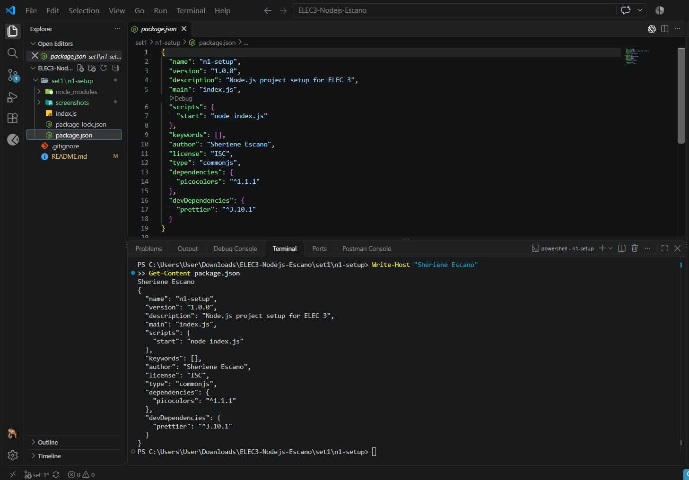
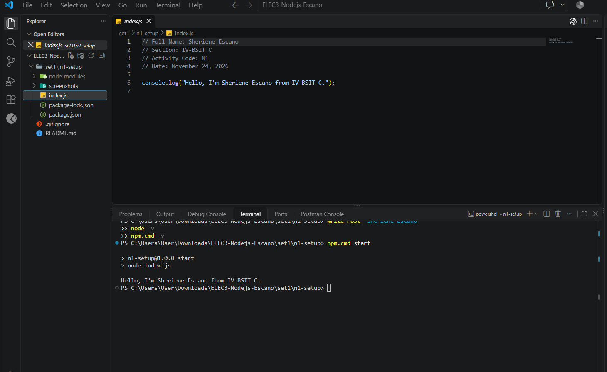

# ELEC3-Nodejs-Escano

- **Full Name:** Sheriene Escano
- **Section:** IV-BSIT C
- **Course:** ELEC 3 - Node.js

## Activities

| Activity | Description | Folder |
|---|---|---|
| N1 - Project Setup and Package Management | Initialize an npm project, install dependencies, and run a start script | [set1/n1-setup](set1/n1-setup) |

## How to Run N1

From the repository root in PowerShell:

```powershell
cd set1/n1-setup
npm.cmd install
npm.cmd start
```

## N1 Screenshots





