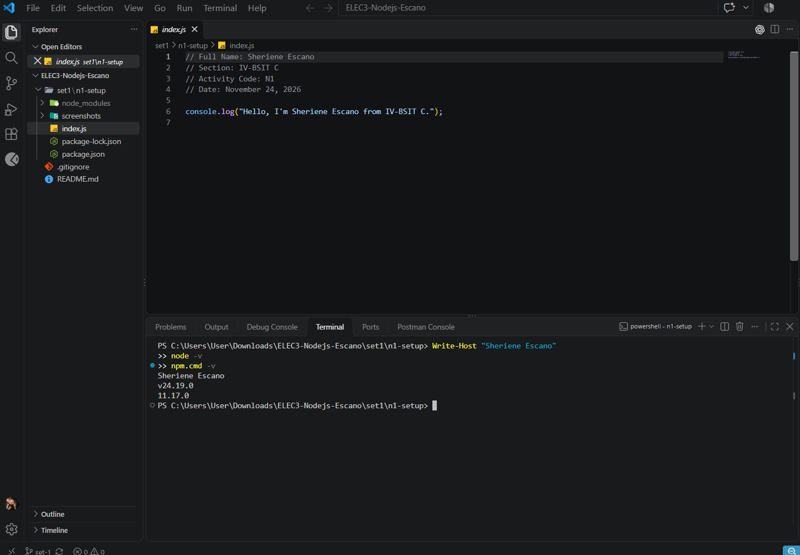
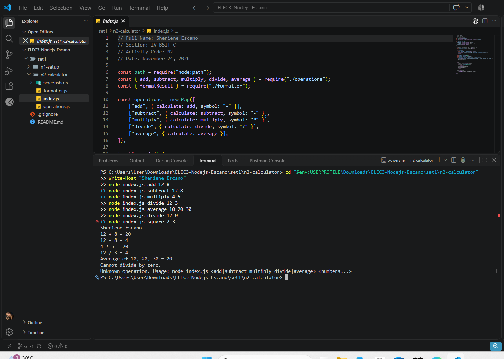
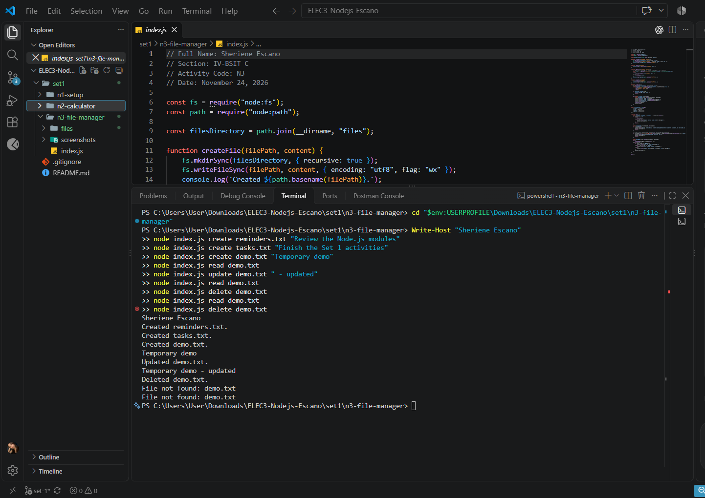
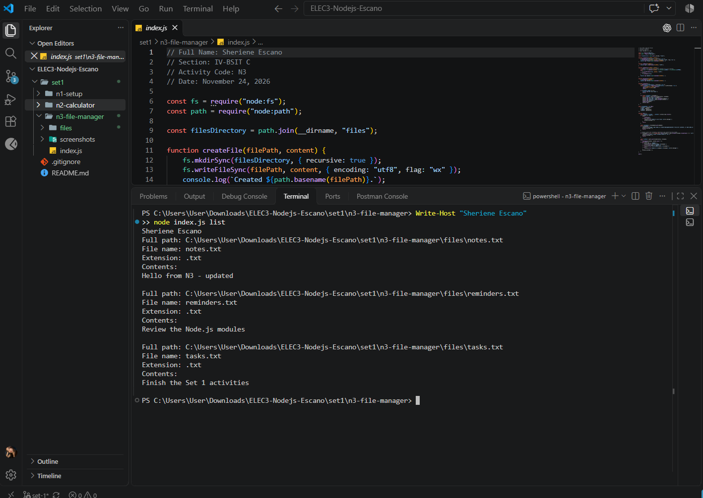

# ELEC3-Nodejs-Escano

- **Full Name:** Sheriene Escano
- **Section:** IV-BSIT C
- **Course:** ELEC 3 - Node.js

## Activities

| Activity | Description | Folder |
|---|---|---|
| N1 - Project Setup and Package Management | Initialize an npm project, install dependencies, and run a start script | [set1/n1-setup](set1/n1-setup) |
| N2 - Modular Calculator | Run five arithmetic operations from the command line | [set1/n2-calculator](set1/n2-calculator) |
| N3 - File Manager | Create, read, append, delete, and list text files | [set1/n3-file-manager](set1/n3-file-manager) |

## How to Run N1

From the repository root in PowerShell:

```powershell
cd set1/n1-setup
npm.cmd install
npm.cmd start
```

## N1 Screenshots




## How to Run N2

From the repository root in PowerShell:

```powershell
cd set1/n2-calculator
node index.js add 12 8
node index.js subtract 12 8
node index.js multiply 4 5
node index.js divide 12 3
node index.js average 10 20 30
```



## How to Run N3

From the repository root in PowerShell:

```powershell
cd set1/n3-file-manager
node index.js create demo.txt "Temporary demo"
node index.js read demo.txt
node index.js update demo.txt " - updated"
node index.js list
node index.js delete demo.txt
```




